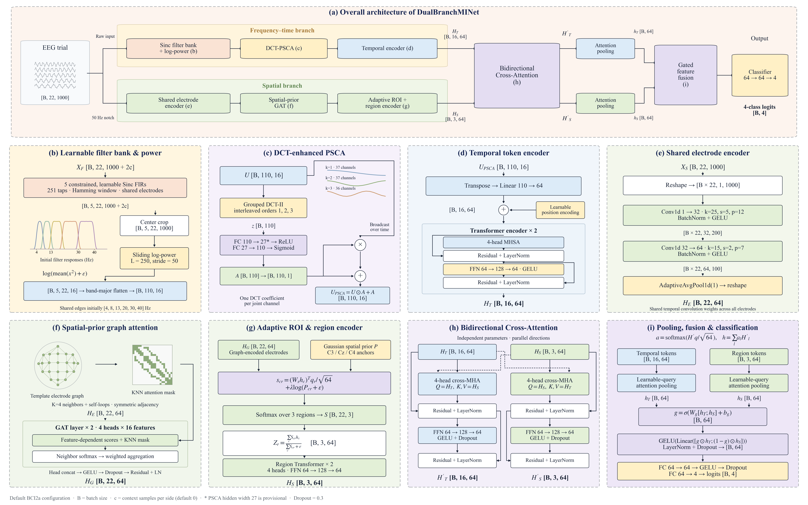

# DualBranchMINet

根据 [第一版模型规格](docs/model_v1.md) 实现的 MI-EEG 双分支网络。当前实现 BCI Competition IV 2a 的被试内四分类，标签依次为左手、右手、双脚、舌头，对应索引 0–3。

[v1 版本说明、训练配置与实测结果](V1.md)

## 模型架构



[可编辑 SVG 架构图](Figure/DualBranchMINet_architecture_v1.svg)

## 文件组织

每个数据集使用独立的配置文件、预处理文件和模型文件。

```text
DualBranchMINet/
├── docs/
│   └── model_v1.md        # 第一版模型规格
├── Figure/                # 架构图与绘图源码
├── config/
│   └── bci2a.yaml          # BCI2a 配置和待确认参数
├── data/
│   └── bci2a.py            # GDF 读取、Cue 截取、预处理、划分与 Dataset
├── model/
│   └── bci2a.py            # 本数据集的模型及全部子模块
├── output/                # 训练时创建，按被试和随机种子保存结果
├── tests/                 # 维度、梯度、数据与训练回归测试
├── test/
│   └── test_model_dimensions.py # 真实数据逐层维度与单 batch 梯度检查
├── train_2a.py             # 逐被试训练及最终测试
├── evaluate.py             # 已保存模型的独立评估
├── metrics.py              # 分类指标与汇总
├── plot_results.py         # 曲线、混淆矩阵及已保存结果的重绘
├── utils.py                # 配置读取
└── requirements.txt
```

## 环境与数据

使用 Python 3.10 或更新版本，安装依赖后从项目根目录执行命令。

本次代码验证环境为 Python 3.10.11、PyTorch 2.8.0 CPU、NumPy 2.2.6、SciPy 1.15.3、scikit-learn 1.7.2、MNE 1.11.0 与 PyYAML 6.0.3。

```bash
python -m pip install -r requirements.txt
```

`config/bci2a.yaml` 已按用户提供的 Linux 服务器位置设置 `paths.data_dir=/home/jqsj/hzy/zwc/data/bci_2a/2a`、`paths.labels_dir=/home/jqsj/hzy/zwc/data/bci_2a/2a_label`。训练、独立评估和维度测试统一读取这两个配置项。配置内的相对路径以项目根目录为基准。`labels_dir` 留空时，会在 GDF 目录内寻找对应标签文件。

```text
GDF目录/
├── A01T.gdf
├── A01E.gdf
├── A02T.gdf
└── ...

标签目录/
├── A01E.mat                # classlabel，取值 1–4，按全部测试 Cue 排列
├── A02E.mat
└── ...
```

数据通过 GDF 的 Cue 事件定位。训练使用事件 769–772，未知类别 Cue 783 使用外部 `classlabel` 标签。先将标签对齐全部 Cue，再按照配置筛除试次。通道对齐使用指定的 22 电极顺序，排除 EOG。

每个分支的目标窗口均为 Cue 后 `[0.5, 4.5)` 秒，采用半开区间得到恰好 1000 点。按照官方时序，运动想象在 Cue 后 4 秒结束，所以该选择包含结束后 0.5 秒，沿用用户的第一版规格。官方发布信号已有采集阶段的带通和陷波处理。本代码的空间分支再执行配置化工频陷波，频率分支输入由可学习 Sinc 核处理。[BCI2a 官方数据说明](https://www.bbci.de/competition/iv/desc_2a.pdf)

每个被试的 Session 1 按类别划分训练和验证，两个输入分支的通道均值与标准差分别只用训练子集拟合。验证集和 Session 2 使用保存的统计量。Session 2 在验证集选定最佳模型后用于最终评估。

## 维度核对

默认配置的各阶段维度可以衔接。`B` 为批量大小，`c` 为每侧上下文点数。

| 模块 | 输入 | 输出 |
| --- | --- | --- |
| Sinc 滤波器组 | `[B,22,1000+2c]` | `[B,5,22,1000+2c]` |
| 中心裁剪 | `[B,5,22,1000+2c]` | `[B,5,22,1000]` |
| 滑窗对数功率 | `[B,5,22,1000]` | `[B,5,22,16]` |
| band-major 展开 | `[B,5,22,16]` | `[B,110,16]` |
| 分组 DCT 描述子 | `[B,110,16]` | `[B,110]` |
| DCT-PSCA | `[B,110,16]` | `[B,110,16]` |
| 时间投影与 Transformer | `[B,16,110]` | `[B,16,64]` |
| 共享时间卷积 | `[B,22,1000]` | `[B,22,64]` |
| GAT | `[B,22,64]` | `[B,22,64]` |
| ROI 分配与聚合 | `[B,22,64]` | 分配 `[B,22,3]`，区域 `[B,3,64]` |
| 区域 Transformer | `[B,3,64]` | `[B,3,64]` |
| 双向交叉注意力 | `[B,16,64]`，`[B,3,64]` | `[B,16,64]`，`[B,3,64]` |
| 两路注意力池化 | 两路 token | 两个 `[B,64]` |
| 门控融合与分类 | 两个 `[B,64]` | 融合 `[B,64]`，logits `[B,4]` |

功率窗口数为 `floor((1000-250)/50)+1=16`。DCT 分组使用 `k=[1,2,3]` 的交错映射，三组分别包含 37、37、36 个联合通道。共享卷积的时间长度依次为 `1000→200→100→1`。GAT 的 4 个头各输出 16 维后拼接为 64 维。交叉注意力的输出长度由 Query 长度决定。

## 第一版实现假设

PSCA 使用文档明确给出的 `U * A + A`，DCT 只沿时间维生成描述子。用户文档缺少 AMFTCNet 原始权重子网络的完整图和参数，当前权重网络使用 `Linear(110,27) → ReLU → Linear(27,110) → Sigmoid`。隐藏维度、激活与 bias 均可在配置中修改，该部分属于临时实现选择。

配置中的临时值包括 Sinc 的 251 taps、Hamming 窗、反射 padding、每侧 0 点上下文，PSCA 权重子网络，KNN 的 4 个邻居，2 层 4 头 GAT，C3/Cz/C4 区域锚点，0.06 米区域带宽、先验强度 1.0、4 头交叉注意力，以及训练集统计归一化与 0.2 验证比例。

电极先验使用本地 MNE 所附 `standard_1005.elc` 模板坐标，转换成米，按 `data.channel_names` 对齐。`model.spatial.coordinates_m` 可填写同顺序的实际坐标。区域带宽 `region_sigma_m` 使用米作为单位。KNN 先选择 K 个其他电极，再加入自环并对称化，因此最终节点度数可以超过 K+1。

Sinc 采用共享边界与 softmax 间隔参数化，保持频率上下界、频带顺序和最小带宽。每侧上下文 `c` 对应频率输入长度 `1000+2c`，滤波后取中心 1000 点。若希望目标窗口完全使用真实滤波上下文，可将每侧上下文设为至少 125 点，并确保原始记录在两侧均有足够数据。

## 模型调用

```python
import torch
from model.bci2a import DualBranchMINet
from utils import load_config

config = load_config()
model = DualBranchMINet(config)
x_spatial = torch.randn(2, 22, 1000)
context = config["model"]["sinc"]["context_samples"]
x_frequency = torch.randn(2, 22, 1000 + 2 * context)
logits, aux = model(x_spatial, x_frequency, return_aux=True)
loss = torch.nn.functional.cross_entropy(logits, torch.tensor([0, 3]))
loss.backward()
```

辅助输出包含 Sinc 截止频率、功率特征、DCT 描述子、PSCA 权重、时间 token、GAT 权重、ROI 分配、区域 token、两个方向的交叉注意力和融合门值。

## 训练、评估和结果

v1 的历史实验、三个改进方案与串行运行命令记录在 [v1 实验记录](docs/v1_experiments.md)。运行 `python -u run_v1_experiments.py --gpu 0`，将在 GPU 0 上依次训练正则化、轻量化、GroupNorm 三组实验，三组均保留频移增强。

当前 `train_2a.py` 默认采用 Session 1 全量训练、每轮测试 Session 2、执行全部指定 epoch，并按最高测试 Acc 保存模型。`--protocol validation` 可运行下文记录的 v1 验证集选模协议。当前增强方式、GPU 3 命令及批量设置见 [全量训练说明](FULL_SESSION1.md)。

配置数据目录后，使用以下命令训练单被试、单随机种子。

```powershell
python train_2a.py --protocol validation --config config/bci2a.yaml --subjects 1 --seeds 42
```

首轮固定随机种子 42。九名被试共 9 次独立训练使用单独的输出目录。

```powershell
python train_2a.py --protocol validation --subjects all --seeds 42 --output-dir output/v1_all
```

省略 `--subjects` 和 `--seeds` 时采用 YAML 中的列表。命令行也支持 `--data-dir`、`--labels-dir`、`--device cpu` 或 `--device cuda`。默认 `device=cuda`，用于安装 CUDA 版 PyTorch 的 Linux 服务器。训练按验证交叉熵最小值保存最佳模型，超过 `patience` 个 epoch 无改善时早停。

```text
output/
├── A01/
│   └── seed_42/
│       ├── config.json
│       ├── split.json
│       ├── normalization.json
│       ├── history.json
│       ├── history.csv
│       ├── accuracy_curve.png
│       ├── loss_curve.png
│       ├── best_model.pt
│       ├── test_metrics.json
│       ├── test_predictions.npz
│       ├── confusion_matrix.png
│       ├── confusion_matrix_normalized.png
│       └── confusion_matrix.csv
├── results.csv
└── summary.json
```

结果包含 Accuracy、Cohen's Kappa、Macro-F1、四分类混淆矩阵、保留和剔除试次信息。Accuracy 使用 0–1 数值。`summary.json` 保存每个种子跨被试、每个被试跨种子的统计，以及先对种子求均值后跨被试汇总的结果。标准差使用 `ddof=1`，只有一个观测时写为 `null`。汇总包含当前输出目录内全部已完成运行，补跑其他被试或种子时会保留既有记录。相同被试和种子的已有运行目录会提示冲突，可通过另一个输出目录组织新实验。

保存的 `split.json` 包含训练和验证的试次索引、Cue 采样点及剔除记录。`best_model.pt` 保存配置、模型参数、所选 epoch 和两路训练归一化统计量。重新评估使用该检查点恢复模型与统计量。

每个被试和种子的训练结束后自动生成 Accuracy、Loss 随 epoch 变化的曲线，包含训练集与验证集，并标注验证损失最低的选定 epoch。曲线纵轴 Accuracy 使用百分数，`history.json` 与 `history.csv` 中的 Accuracy 保留 0–1 原始数值。CSV 保存逐 epoch 的训练和验证 Accuracy、Loss，可用于后续重新作图。

最佳模型在 Session 2 上评估后，自动生成计数混淆矩阵和按真实类别行归一化的百分比混淆矩阵。横轴为预测类别，纵轴为真实类别，顺序为左手、右手、双脚、舌头。图表同时提供 PNG 和可编辑 SVG，绘图采用 Agg 后端，支持服务器无图形界面运行。绘图依赖 `matplotlib`，已加入 `requirements.txt`。

现有运行目录中的 `history.json` 和 `test_metrics.json` 也可直接用于重绘。

```bash
python plot_results.py --run-dir output/A01/seed_42
```

```powershell
python evaluate.py --checkpoint output/A01/seed_42/best_model.pt
```

数据移动后可传入新的 `--data-dir` 和 `--labels-dir`。重新评估默认保存到检查点旁的 `evaluation/` 目录。

## 本地验证

测试使用 Python 自带的 unittest。

```powershell
python -m unittest discover -s tests -v
```

测试覆盖逐模块形状、Sinc 截止频率约束与非零梯度、DCT 与 SciPy 系数对照、GAT mask、ROI 分配、双向交叉注意力、单 batch 参数更新、Cue 与标签对齐、训练集统计量，以及一次合成数据训练与检查点重新评估。训练流程测试在工作区内创建临时目录，退出后自动清理。

`tests/` 中的随机信号和合成事件用于验证代码行为。真实数据的逐层检查使用 `test/test_model_dimensions.py`，它复用正式数据读取、划分和归一化接口。

```powershell
python test/test_model_dimensions.py --subjects 1
python test/test_model_dimensions.py --subjects all
```

该脚本检查训练、验证和测试输入的维度、各模块输出、数值有限性与注意力归一化，同时覆盖 batch 大小为 1 和不足整批的尾批次。它使用 Session 1 的一个训练 batch 验证反向传播和优化器更新。归一化仍只拟合 Session 1 训练子集，Session 2 用于前向维度验证。检查结果写入 `test/dimension_check_report.json`。单 batch 的更新服务于代码诊断，正式分类实验结果由 `train_2a.py` 的训练与评估产生。
