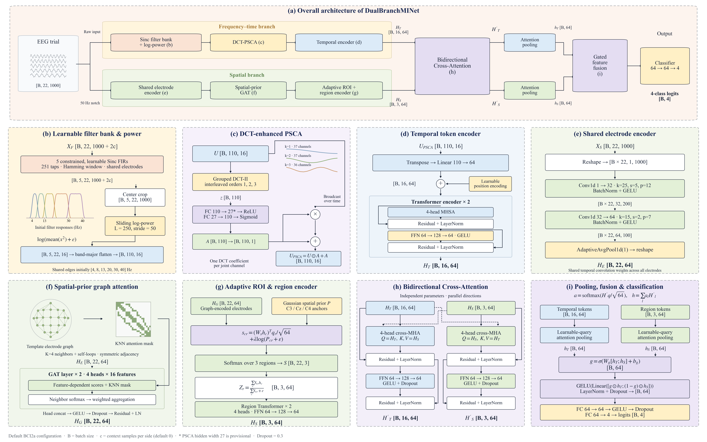

# MINet v1 版本说明

本版本保存 DualBranchMINet 的第一版实现，版本日期为 2026-11-26，Git 标签为 `v1`。任务为 BCI Competition IV 2a 的被试内四分类运动想象解码。模型共有 **288,264 个可训练参数**。

## 架构图



[SVG 矢量图](Figure/DualBranchMINet_architecture_v1.svg) · [绘图源码](Figure/draw_architecture_v1.py) · [原始模型规格](docs/model_v1.md)

## 模型结构与维度

两个分支处理同一试次，并通过双向交叉注意力交互。默认每个试次包含 22 个 EEG 电极、1000 个采样点。

| 阶段 | 输出形状 | v1 设置 |
| --- | --- | --- |
| 共享 Sinc 滤波器组 | `[B,5,22,1000]` | 初始边界 `[4,8,13,20,30,40] Hz`，边界可学习 |
| 滑窗对数功率 | `[B,5,22,16]` | 窗长 250 点，步长 50 点 |
| 频带与电极展开 | `[B,110,16]` | band-major 顺序 |
| DCT-PSCA | `[B,110,16]` | DCT 阶数 1、2、3，交错分组为 37、37、36 通道 |
| 时间投影与 Transformer | `[B,16,64]` | 线性投影 110→64，学习式位置编码，2 层 4 头 |
| 共享电极时间卷积 | `[B,22,64]` | 两层 Conv1d，通道 1→32→64，时间长度 1000→200→100→1 |
| 空间先验 GAT | `[B,22,64]` | KNN K=4，自环、对称化，2 层 4 头 |
| 自适应 ROI 聚合 | `[B,3,64]` | C3、Cz、C4 锚点，分配矩阵 `[B,22,3]` |
| 区域 Transformer | `[B,3,64]` | 2 层 4 头 |
| 双向交叉注意力 | `[B,16,64]` 与 `[B,3,64]` | 两方向参数独立，均读取交互前的 token |
| 注意力池化与门控融合 | `[B,64]` | 两分支分别池化，逐维 sigmoid 门控 |
| 分类头 | `[B,4]` | 64→64→4，输出 logits |

所有 Transformer 和交叉注意力的特征维度为 64，FFN 隐藏维度为 128，使用 GELU。PSCA 运算为 `U * A + A`，通道权重子网络为 `110→27→ReLU→110→Sigmoid`。该子网络的隐藏维度 27 属于第一版临时实现选择，与 AMFTCNet 原始权重子网络的一致性仍待核对。

Sinc 核长为 251 taps，使用 Hamming 窗。默认每侧上下文为 0 点，边界采用反射填充。空间先验来自 MNE 附带的 standard_1005 模板坐标，ROI 高斯带宽为 0.06 m，先验强度为 1。

## 数据与训练协议

- 采样率为 250 Hz，Cue 后截取 `[0.5,4.5)` 秒，恰好 1000 点。该窗口包含运动想象结束后的 0.5 秒。
- 空间输入按试次执行 50 Hz 陷波，频率输入通过模型内部 Sinc 滤波器组处理。
- 每名被试单独训练。Session 1 按类别分层划分训练与验证，验证比例为 0.2，当前数据对应 230 条训练和 58 条验证试次。
- 两个分支分别只用训练子集拟合通道均值、标准差，再应用到验证与测试数据。
- 保留伪迹标记试次，使用全部 22 个 EEG 通道。类别顺序为左手、右手、双脚、舌头，索引为 0–3。
- 按验证交叉熵最低值保存最佳模型，训练结束后在 Session 2 上进行最终评估。

| 超参数 | v1 默认值 |
| --- | --- |
| 优化器 | AdamW |
| 学习率 | 0.0003，固定学习率 |
| Weight decay | 0.0001 |
| Batch size | 32 |
| 最大 epoch | 200 |
| 早停 patience | 30 |
| Dropout | 0.3 |
| 随机种子 | 42 |
| 设备 | CUDA |
| 精度 | FP32 |
| 数据增强 | 关闭 |

当前训练种子同时控制分层划分和模型随机性。回传运行的 `config.json` 保留了早期的种子列表 `[42,2026,2027]`，实际运行通过命令行选择了 42，最终完成的九个结果均记录 `seed=42`。本版本默认配置已设为 `[42]`。

## 首轮实测结果

以下结果来自用户回传的 `output/v1_seed42`，每名被试的测试集均为 288 条试次。验证 Acc 对应按最低验证 Loss 选定的模型。

| 被试 | 验证 Acc | 测试 Acc | 选中 epoch |
| --- | --- | --- | --- |
| A01 | 44.83% | 36.11% | 19 |
| A02 | 31.03% | 28.12% | 1 |
| A03 | 50.00% | 49.65% | 25 |
| A04 | 37.93% | 37.85% | 17 |
| A05 | 22.41% | 26.04% | 5 |
| A06 | 29.31% | 29.17% | 5 |
| A07 | 44.83% | 38.54% | 27 |
| A08 | 41.38% | 38.19% | 16 |
| A09 | 53.45% | 52.43% | 21 |

九名被试的平均测试 Accuracy 为 **37.35%**，被试间样本标准差为 **9.10 个百分点**。平均 Macro-F1 为 **33.58%**，平均 Cohen's Kappa 为 **0.1646**。该统计对应单个随机种子。

逐试次预测重算的 Accuracy 与结果 JSON 一致，保存的测试标签与本地配套 MAT 标签逐项一致。训练末轮的跨被试平均训练 Acc 为 90.00%，平均验证 Acc 为 37.55%，曲线呈现明显过拟合。A05 和 A06 的舌头类别测试召回率为 0，存在类别预测偏向。具体模块贡献需要通过后续消融实验判断。

[原始逐被试结果 CSV](docs/results/v1_seed42_results.csv) · [原始汇总 JSON](docs/results/v1_seed42_summary.json)

## 运行与输出

默认数据路径为 `/home/jqsj/hzy/zwc/data/bci_2a/2a`，标签路径为同级的 `2a_label`。在安装 CUDA 版 PyTorch 和项目依赖的环境中，从项目根目录执行以下命令。

```bash
CUDA_VISIBLE_DEVICES=0 python -u train_2a.py \
  --subjects all --seeds 42 --device cuda:0 \
  --output-dir output/v1_seed42
```

每个被试与种子拥有独立的结果目录，保存最佳模型、配置、划分索引、归一化统计量、逐 epoch 指标、测试指标和逐试次预测。训练和独立评估入口已集成 PNG、SVG 绘图，包含训练与验证 Acc、Loss 曲线，以及计数版和行归一化版测试混淆矩阵，同时导出 CSV。已有记录可通过 `python plot_results.py --run-dir <运行目录>` 重绘。

本仓库包含源码、配置、测试、维度检查报告、架构图及上述实测结果摘要。原始 EEG、完整训练输出和模型检查点由运行目录单独保存。

## 验证范围

```bash
python -m unittest discover -s tests -v
python test/test_model_dimensions.py --subjects all --device cuda
```

已完成真实数据九名被试、18 个会话的读取检查，CPU 下 54 次批次维度检查覆盖 batch 大小 1、6、26、32，九次训练批次反向传播和参数更新通过。训练、独立评估和图表生成另有合成数据回归测试。本版本的首轮分类实验由用户在 Linux CUDA 服务器完成。
